# RPS Rivals

<div align="center">

[](https://claude.ai/code)


### 🤖✨ This is a Claude-run operation ✨🤖

***Coded on only the purest of vibes.***

</div>

---

<div align="center">

<a href="https://robinneefs.github.io/rps-rivals/"></a>

**Free · No install · Desktop and phone**

vs the CPU, or vs a friend online with a 4-letter room code

<sub>The big revamp described below is on the <a href="https://robinneefs.github.io/rps-rivals/staging/">staging copy</a> for playtesting; the live game updates when it is released.</sub>

</div>

---

## The game

RPS Rivals is a pixel-art arcade fighter built on rock paper scissors. Two fighters face off on the CRT monitor of an upright '90s arcade cabinet. Each exchange, both players secretly pick **Rock**, **Paper** or **Scissors** on the cabinet's big buttons before a 3 second countdown runs out. The picks fly in as coins, collide in the middle of the screen, the winning move lands and the loser takes damage. Knock your rival out twice to win the match.

**Pick a fighter.** Each of the three fighters plays differently:

| Fighter | Style | Health | Rock | Paper | Scissors |
|---|---|---:|---:|---:|---:|
| Taiko | All-rounder | 100 | 25 | 25 | 25 |
| Riot | Fragile scissors specialist | 80 | 15 | 15 | 35 |
| Anchor | Rock tank | 120 | 50 | 5 | 5 |

- Rock beats Scissors, Scissors beats Paper, and Paper beats Rock. The winning move deals its damage; matching moves clash for no damage.
- Miss the countdown and a move is picked for you (marked AUTO). **Anchor always auto-picks Rock**; Taiko and Riot get a random move.
- Mirror matches give the second fighter an alternate colour scheme.
- Five animated stages, each with its own soundtrack: **City Rooftop**, **Storm Field**, **Sunset Harbor**, **Lantern Courtyard** and **Foundry Floor**.
- Play against the CPU, or against a friend online with a 4-letter room code.
- The game runs on a native **192 × 240** pixel grid, shown through a CRT effect (scanlines, glow and screen curvature) that you can switch off in Options. **Pixel perfect** mode scales by whole device pixels only.

### A match, start to finish

Home → choose your fighter → a versus screen slams the two portraits together → **ROUND 1 / FIGHT!** → pick before the countdown runs out → the coins collide and the hit lands → **K.O.** → next round → the victory splash with **Rematch** or **Main menu**. Online matches follow the same flow and show YOU and RIVAL instead of YOU and CPU.

### Controls

| | Desktop | Phone |
|---|---|---|
| Pick Rock / Paper / Scissors | keys **1 / 2 / 3**, or click the buttons | tap the buttons |
| Move through menus | arrow keys, or drag the joystick | drag the joystick, or tap an item |
| Select / back | any button, Enter or Space / Esc | any button / the BACK item |

## Screenshots

| Home | Choose fighter | Versus | Pick |
|---|---|---|---|
| 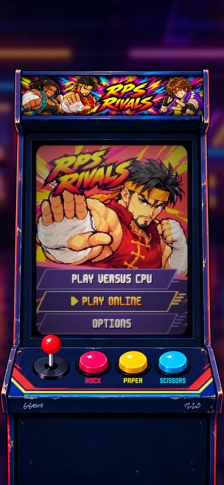 | 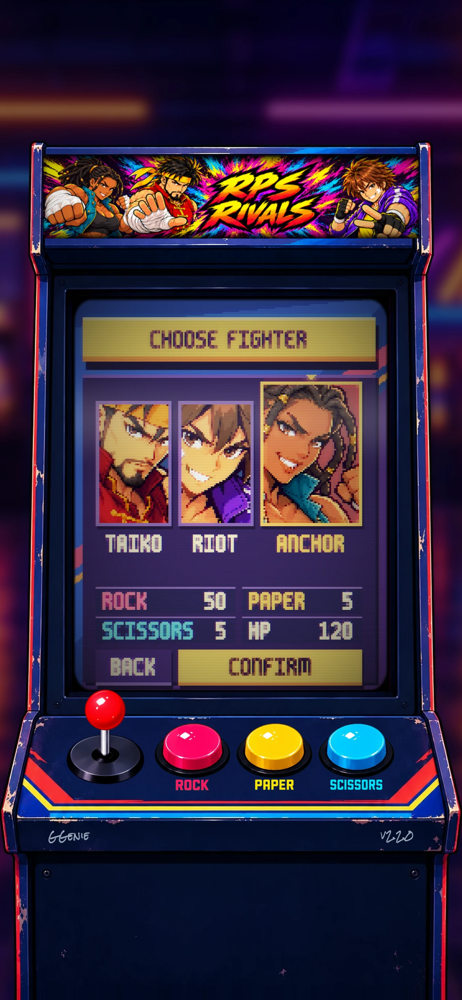 | 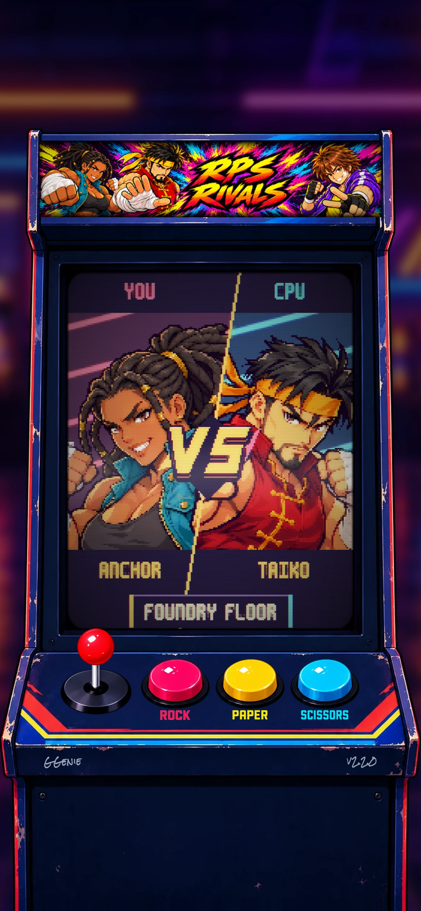 | 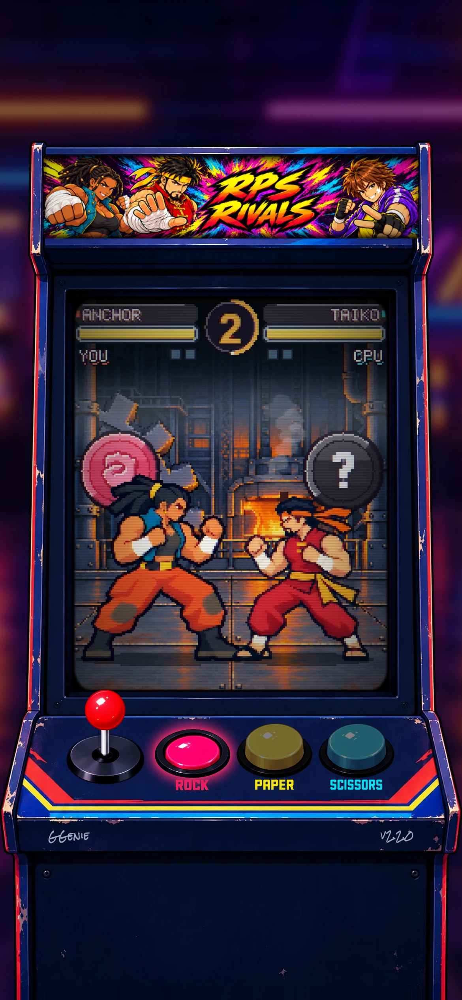 |
| **Clash** | **K.O.** | **Victory** | **Online** |
| 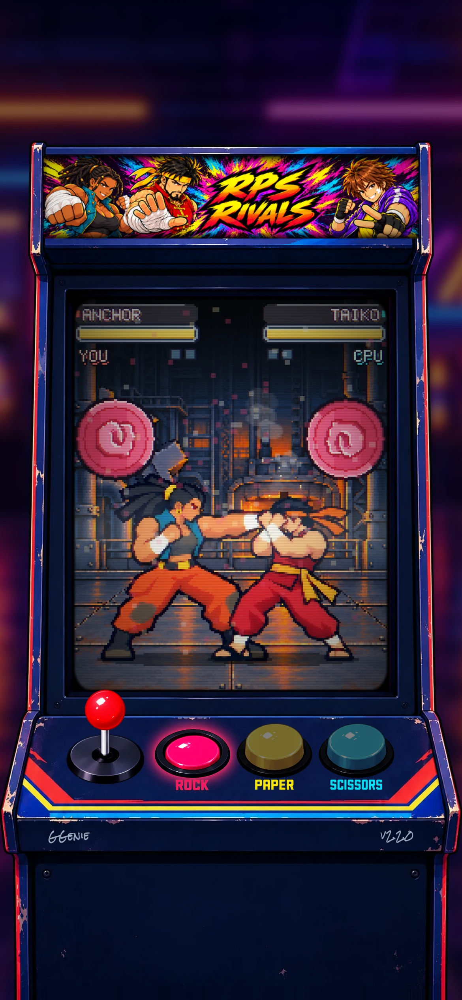 | 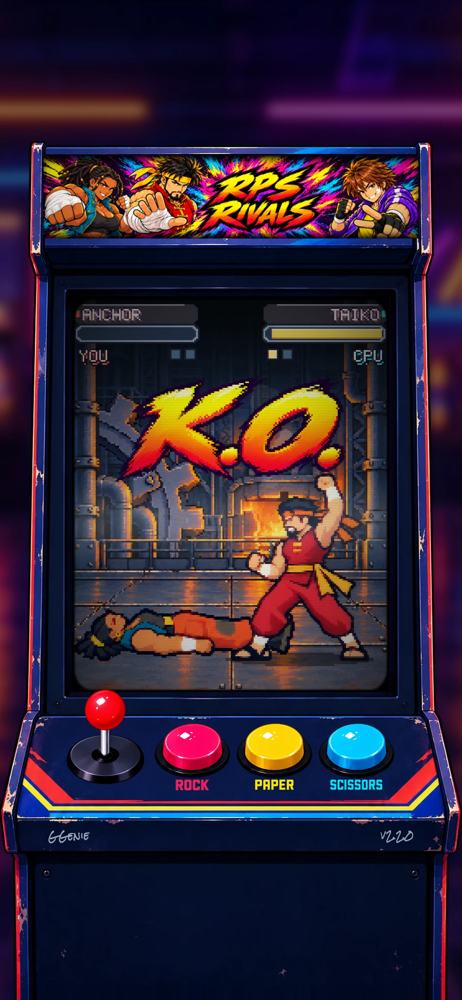 | 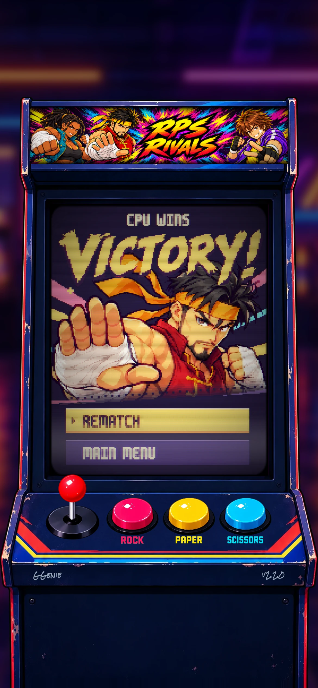 | 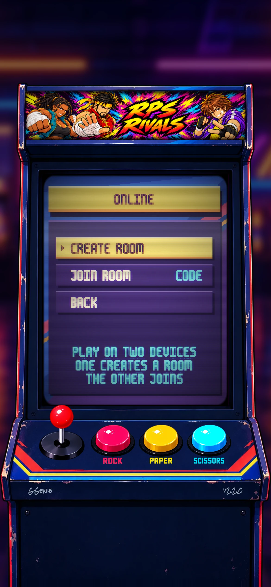 |

**The five stages**

| City Rooftop | Storm Field | Sunset Harbor | Lantern Courtyard | Foundry Floor |
|---|---|---|---|---|
| 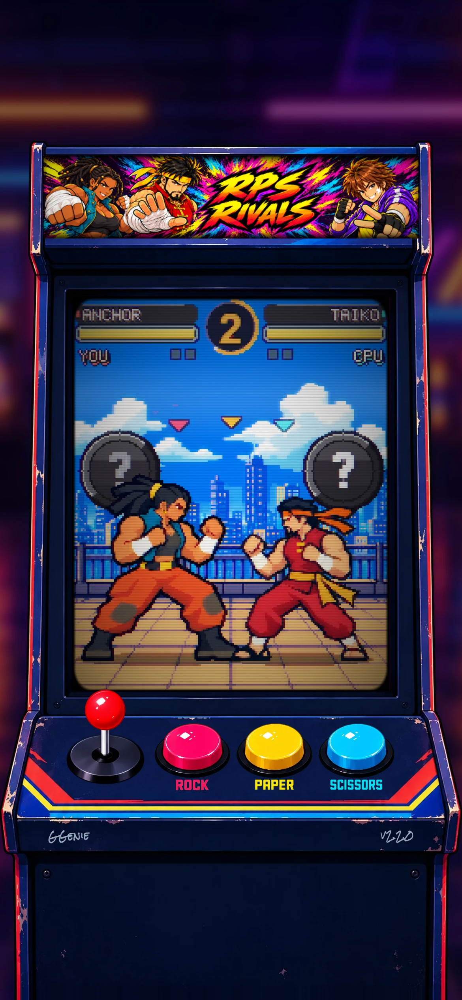 | 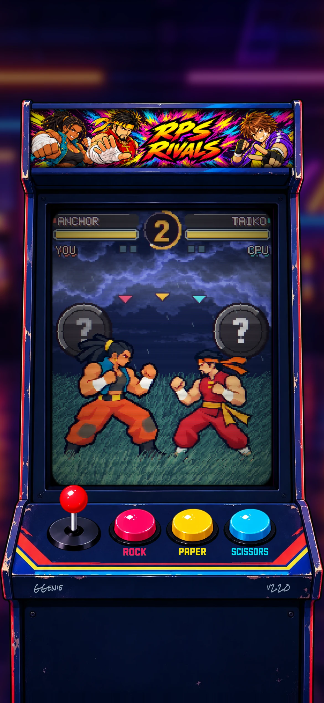 | 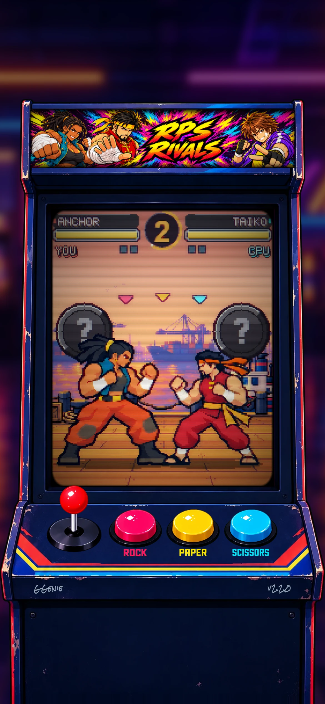 | 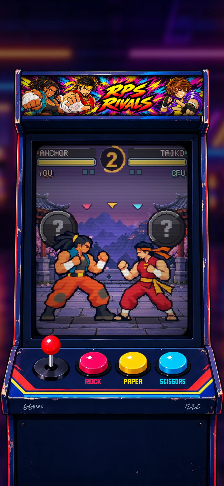 | 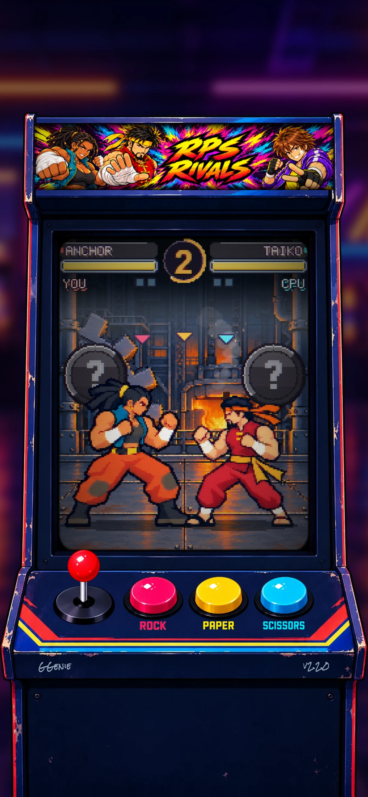 |

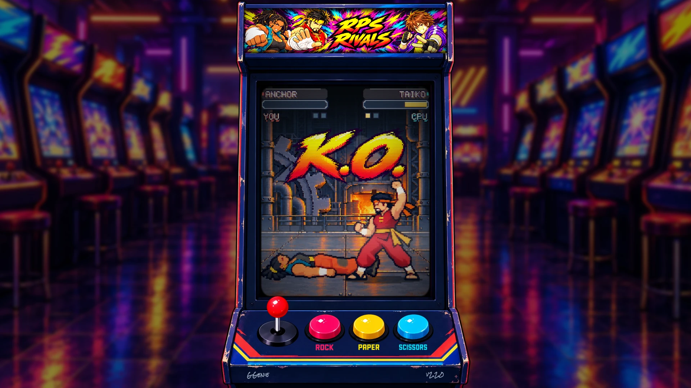

<sub>Captured from the production build by `node sources/screenshots/capture.mjs` (seeded, so reruns come out much the same).</sub>

## Built with

| Part | What |
|---|---|
| Game engine | [Phaser 3](https://phaser.io/), pixel-art mode on a native 192 × 240 framebuffer, with a WebGL CRT pass at display resolution |
| Language | [TypeScript](https://www.typescriptlang.org/) (strict), in an npm workspace monorepo |
| Build and dev server | [Vite](https://vite.dev/) |
| Online match server | [Cloudflare Workers](https://workers.cloudflare.com/) with one Durable Object per room, over WebSockets |
| Hosting | GitHub Pages (game) and Cloudflare (match rooms), deployed by GitHub Actions |
| Tests | [Vitest](https://vitest.dev/) for the rules, referee, sessions, stages and audio; [Playwright](https://playwright.dev/) for in-browser match, menu and online-return tests |
| Code quality | ESLint (with layer import rules) and Prettier |
| Dev tools | Effects Studio (CRT and screen-effect controls) and a round-review harness; the legacy [Tweakpane](https://tweakpane.github.io/docs/) panel. Dev builds only |
| Art and sound tools | Node scripts (Playwright for captures and checks, ffmpeg for audio) and Python + Pillow, all in `tools/` |

## How it's built

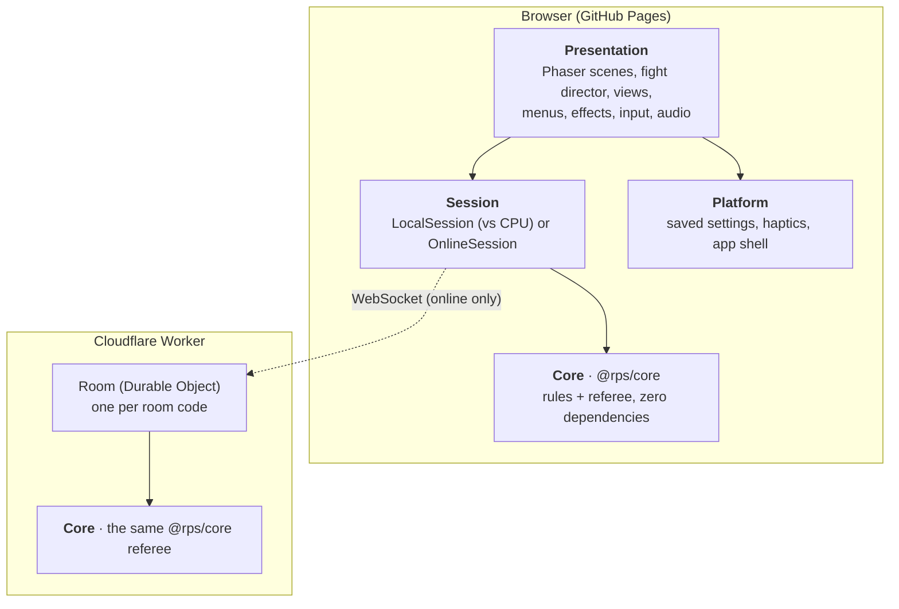

- **Core** (`packages/core`) holds the rules (who wins, damage, health, rounds) and the referee that runs the match phases. It's plain TypeScript with no engine, timers or network, so the exact same code referees online matches on the server.
- **Session** is "a match in progress" from one player's side. Against the CPU it runs the referee locally; online it talks to the room. The rest of the game can't tell the two apart.
- **Presentation** draws and animates everything and never decides a result. Dependencies only point down, and the linter enforces it.
- **Online**, the room keeps both picks secret until the reveal and runs the clock, so neither player can peek or stall.

The full write-up, with diagrams, is in [docs/architecture/ARCHITECTURE.md](docs/architecture/ARCHITECTURE.md).

## Assets and credits

Nearly everything in the game is generated by code in this repository, and every asset is disclosed below.

| Asset | Where it comes from |
|---|---|
| Fighters (Taiko, Riot, Anchor): combat sprite sheets, portraits and alternate colours | AI-generated with built-in image generation, then reduced to the native grid by scripts in `tools/art/`. Sources, prompts and reviews: `art/fighters/`, `art/portraits/`, `art/menus/`. |
| Stages (City Rooftop, Storm Field, Sunset Harbor, Lantern Courtyard, Foundry Floor) | AI-generated layers and animation frames, exported to the native grid by `tools/art/`. Sources and prompts: `art/stages/`. Stage effects (rain, lightning, birds, water, lanterns, smoke, sparks) are animated in code. |
| Home, character select, versus and victory artwork | AI-generated layers prepared on the native grid. Sources/prompts: `art/menus/`. |
| Combat UI: hand coins and K.O. lettering | AI-generated v6 hand pictograms and K.O. lettering, embossed and coloured in code. Studies: `art/ui/`. |
| Marquee art (the RPS RIVALS banner) | AI-generated by the project owner, prepared at 733 × 161. Studies: `art/cabinet/marquee-v5` to `marquee-v7`. |
| Cabinet, buttons and joystick | AI-generated painted cabinet, with the joystick drawn in all directions. Sources: `art/cabinet/`. |
| Chain Shift studio logo | The project owner's original logo, prepared at native resolution with a clipped sheen by `tools/art/prepare-studio-logo.py`. Sources and captures: `art/brand/chain-shift-v2/`. |
| Menu and HUD lettering | m6x11 by Daniel Linssen, [free use with attribution](https://managore.itch.io/m6x11). Font and attribution in `art/fonts/m6x11/`. |
| Cabinet engraved lettering | Rock Salt by Sideshow / Font Diner, Inc., Apache 2.0. Font/licence in `art/fonts/rock-salt/`. |
| Pixel font (5×7) and legacy placeholder graphics | Designed in code for this project (`apps/game/src/assets/`). Original. |
| Font studies (not shipped) | Pixelify Sans (SIL OFL 1.1), Spleen (BSD 2-Clause), Tamzen, Cozette, Jersey 10, m5x7, ThaleahFat: each with its licence in `art/fonts/`. |
| Music and sound effects | Original chiptune synthesis, no samples: the menu theme **One More Round** and one theme per stage (**Ready to Rival**, **Under the Storm**, **Golden Hour**, **Lantern Rush**, **Pressure Point**). See [docs/audio/AUDIO.md](docs/audio/AUDIO.md). |
| Browser icon and link preview image | Made from the game's own button and marquee art by `tools/make-icons.mjs`. |
| Code and docs | Written by Claude (Anthropic) in Claude Code, and by OpenAI Codex, directed by the project owner. |
| Phaser, Tweakpane and the other libraries | Used under their own open source licences (MIT). |

## Run it locally

Needs Node 22.

```sh
npm install
npm run dev          # the game at http://localhost:5173
npm run dev:server   # optional: a local match server for online play (ws://localhost:8787)
```

In development, **Effects Studio** opens by default; **F4** hides or shows it. Useful URL options:

| Add to the URL | What it does |
|---|---|
| `?stage=storm-field` | Every match uses that stage (`rooftop`, `storm-field`, `sunset-harbor`, `lantern-courtyard`, `foundry-floor`). Works in production builds too |
| `?roundReview&beat=0` | The 19-beat combat review: each step of a round on the real fight screen, held, with Previous / Next / Replay (dev only) |
| `?menuReview=characters` | Opens one screen directly: `online`, `create`, `join`, `characters`, `victory`, `win`, `loss`, or `stage&stage=<id>` (dev only) |
| `?legacyTuning` | The original all-values tuning panel (dev only) |

See [the tuning guide](docs/tuning/TUNING-PANEL.md).

| Command | What it does |
|---|---|
| `npm test` | Rules, referee and session tests (Vitest) |
| `npm run test:e2e` | Browser tests (Playwright; full CPU matches, menus, online return) |
| `npm run lint` | ESLint, including the layer import rules |
| `npm run typecheck` | TypeScript, strict |
| `npm run build` | Production build into `apps/game/dist` |
| `npm run audio` | Regenerate the sound effects and the original loops (needs ffmpeg); each stage theme has its own script, see [AUDIO.md](docs/audio/AUDIO.md) |
| `node sources/screenshots/capture.mjs` | Rebuild and recapture every screenshot in `docs/screenshots/` |

## Repository layout

| Path | What's in it |
|---|---|
| [`packages/core/`](packages/core/) | `@rps/core`: the rules and the referee, zero dependencies |
| [`apps/game/`](apps/game/) | The Phaser game: cabinet, scenes, views, sessions, input, audio, CRT, tuning |
| [`apps/server/`](apps/server/) | The online match server: a Cloudflare Worker with a Durable Object per room |
| [`tools/`](tools/) | Scripts that prepare the art (fighters, stages, menus, UI), make the icons and compose all audio |
| [`art/`](art/) | Art and music sources: generated originals, exact prompts, studies, exports and review captures |
| [`docs/`](docs/) | Architecture, release checklist, audio notes, tuning guide, screenshots, mock-ups and art direction |
| [`sources/`](sources/) | Scripts that draw the mock-ups and diagrams and capture the screenshots |
| [`PROJECT_CONTEXT.md`](PROJECT_CONTEXT.md) | Full project context: rules, decisions and the decision log |
| [`CHANGELOG.md`](CHANGELOG.md) | What changed in every version |

## Privacy

No accounts, no ads, no tracking. Your settings (CRT screen, pixel perfect, haptics, sound and volumes) are saved in your own browser. Online matches only send your picks to the match room, which forgets everything when the match ends.

## License

[MIT](LICENSE)
